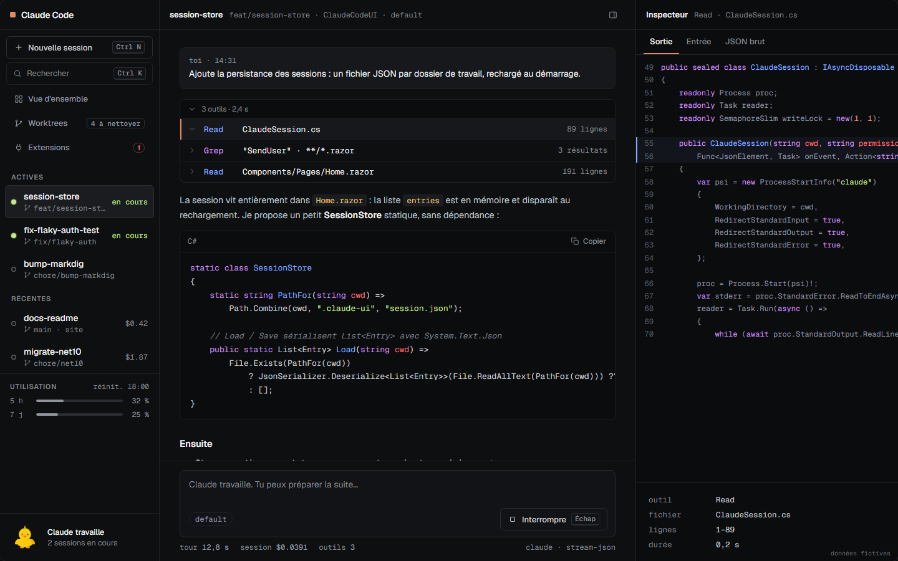

**English** · [Français](README.fr.md)

# Claude Code UI

A desktop console for [Claude Code](https://docs.claude.com/en/docs/claude-code/overview). The app drives the real `claude` CLI (stream-json protocol, the same options as the SDK and the VS Code extension) and shows sessions more readably than a terminal: live text, a tool log, permissions with diffs, several sessions in parallel, git worktrees. The interface is available in French and English; dark themes only.



## Installation

Download the installer for your system from the [GitHub releases](https://github.com/Atypical-Consulting/ClaudeCodeUI/releases/latest) page. No .NET SDK or particular browser is needed: the app bundles its own server and uses the system web view.

| System | File | Note |
|---|---|---|
| Windows 10/11 | `.msi` or `-setup.exe` | Unsigned installer: SmartScreen shows "Windows protected your PC". Click "More info", then "Run anyway". WebView2 is already included in Windows 11. |
| macOS (Apple Silicon) | `.dmg` (`aarch64`) | Signed with a Developer ID and notarized by Apple: it opens normally, no workaround needed. Intel Macs are not supported (macOS 26 is their last version). |
| Linux x64 | `.AppImage` or `.deb` | Requires WebKitGTK 4.1 (`libwebkit2gtk-4.1-0` on Debian/Ubuntu, already installed on most desktops). For the AppImage: `chmod +x`, then run it. |
| Linux arm64 | `.AppImage` or `.deb` (`aarch64` / `arm64`) | Same requirements as Linux x64 (Raspberry Pi 5, Asahi Linux, ARM servers and laptops). |

**Verify your download.** Each release ships a `SHA256SUMS` file (`shasum -a 256 -c SHA256SUMS`) and GitHub build-provenance attestations: `gh attestation verify <file> -R Atypical-Consulting/ClaudeCodeUI`.

**Updates.** Every version after 0.1.0 updates itself: a few seconds after startup it checks the latest GitHub release and, when there is a new one, offers to install it and restart. You can also check at any time with *Check for Updates…* (app menu on macOS, Help menu on Windows and Linux), or *Check for updates* in Settings › About and the command palette. Updates are signed, and the signature is verified before anything is installed. Version 0.1.0 has no updater: install the next version by hand once. With the `.deb` or `.rpm` package, installing an update asks for your password.

### Requirement: Claude Code

The Claude Code CLI must be installed and signed in:

```sh
# macOS, Linux, WSL
curl -fsSL https://claude.ai/install.sh | bash
# Windows (PowerShell)
irm https://claude.ai/install.ps1 | iex
```

Then run `claude` once in a terminal to sign in. If `claude` is not found in the PATH, the app shows a help screen instead of the start screen. On macOS, the app reads the PATH of your login shell, so an installation done through `~/.zshrc` is picked up.

## Features

- New session: folder, isolated worktree (generated name), permission mode; the session opens, then you write the first message.
- Live text, thinking indicator, tool log with an inspector (output, input, JSON).
- Permission requests with diffs: allow, deny, or always allow (this session, or local, project or user settings), with why the CLI asked and which subagent asks.
- Permission rules manager, MCP elicitation forms and sign-in, plugin and marketplace management, hooks editor, auto-memory, output styles and `/config`.
- Compaction card, uncommitted changes (`/diff`), thinking, bookmarks, copy, rewind; send now, `@agent` mentions, PDF attachments, prompt suggestions.
- Rename, export, PR link, account and status, background sessions, Remote Control.
- Overview of all sessions and a queue of pending decisions (Ctrl ⇧ A).
- Command palette (Ctrl K), resume recent sessions with their history.
- Model, effort, subagents, context, MCP servers, skills and plugins.
- 5 h / 7 day quota, cost per turn.
- Worktrees: ranking and safe cleanup.
- Five dark themes and an adjustable code size.

## Development

Requirements: Rust (stable) with the `wasm32-unknown-unknown` target, [trunk](https://trunkrs.dev/) and the Tauri CLI, plus the [Tauri prerequisites](https://v2.tauri.app/start/prerequisites/) for your system.

```sh
rustup target add wasm32-unknown-unknown
cargo install trunk tauri-cli --locked
```

Everything is one Cargo workspace: `crates/shared` (types and pure helpers, native and wasm), `crates/core` (the backend: `claude` processes, sessions, transcripts, worktrees…), `ui` (the Leptos interface, compiled to wasm by trunk) and `desktop/src-tauri` (the Tauri shell). See [docs/ARCHITECTURE.md](docs/ARCHITECTURE.md).

```sh
cargo tauri dev                # launches the window; trunk serves and rebuilds the UI on every change
cargo tauri build              # builds the installers into target/release/bundle
cargo test --workspace         # unit tests (the backend runs without Tauri)
cargo check -p ccui-ui --target wasm32-unknown-unknown
```

The interface runs in the system web view and talks to the backend in the same process through Tauri commands and events: no server, no port, no token. The `claude` processes stop with the app.

## Releasing

1. Commits follow [Conventional Commits](https://www.conventionalcommits.org/en/) (`feat:`, `fix:`, `docs:`, `ci:`, `chore:`).
2. On every push to `main`, [release-please](https://github.com/googleapis/release-please) opens or updates a release PR: CHANGELOG, and the version in `tauri.conf.json`, `Cargo.toml` and `Cargo.lock`.
3. Merging that PR creates the tag and the GitHub release. The `release.yml` workflow then builds the Windows, macOS (Apple Silicon) and Linux installers and attaches them to the release.

## License

[MIT](LICENSE) © 2026 Atypical Consulting
